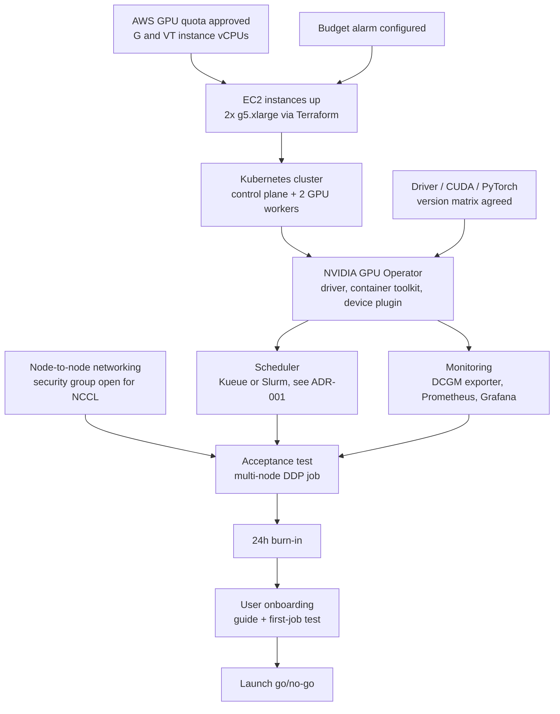

# Dependency Map

Each box can start only after everything pointing into it is finished. The critical path is the top chain: if the GPU quota request is late, everything slips with it. That's why the quota request is filed on day one, before any other work starts.

## External dependencies

These are the ones the program doesn't control, so they get watched more closely.

| Dependency | Owner | Lead time | What happens if it slips |
|---|---|---|---|
| AWS GPU quota increase | AWS support | Hours to several days | All build work waits. Fallback is another region or a different instance family. |
| NVIDIA driver and GPU Operator release compatibility | NVIDIA (upstream) | n/a | Pin known-good versions and don't upgrade during the program |
| PyTorch build for the chosen CUDA version | PyTorch (upstream) | n/a | Choose the CUDA version from what PyTorch ships, not the other way round |

## Internal dependencies worth calling out

- The version matrix (driver, CUDA, PyTorch, NCCL) has to be agreed before the GPU Operator goes in. Changing it later means redeploying the operator and rebuilding the training image.
- The acceptance test needs both the scheduler and monitoring. Without monitoring, "the job finished" doesn't tell you whether the GPUs were actually busy.
